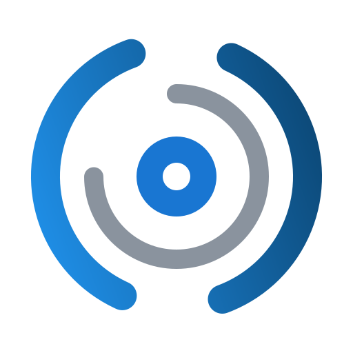

  

# AgentVis OS

**AgentVis OS** builds the missing layers between **LineageOS** and AI
agents: an operating-system-integrated agent platform where on-device agents
can **see** the screen, **reason** about it with vision-language models, and
**act** — with the permissions, SELinux policy and product integration that a
real OS component requires. Not a sideload; a resident.

## Projects

### [AIPhoneAssistant](https://github.com/AgentVis-OS/aiphone_assistant)

A system-level Android agent for screen understanding and input automation.

- **Conversation-driven**: every task is a conversation, with a full
  screenshot-annotated transcript of every step the agent took
- **See → think → act**: screen capture → vision-LLM analysis → input
  injection, gated by a change detector so the model is only invoked when it
  matters
- **Deep OS integration**: privileged `system_ext` app (screen capture +
  input injection via platform permissions), live task notifications, and an
  on-screen interrupt the user can always reach
- **Task lifecycle**: automatic completion detection ("done" protocol with
  summaries), stall watchdogs, user interrupts — with the whole state
  machine persisted per conversation in SQLite

### [WD40](https://github.com/AgentVis-OS/WD40)

The system-integration counterpart — everything the agent needs *outside its
own source tree*:

- SELinux policy for screen capture and input injection (`system_app` domain)
- `lineage_wd40_*` lunch products that integrate the agent into LineageOS
  builds with zero upstream edits
- Porting guides for three tiers: ROM builders, manual integrators, Magisk
  users
- Named for the machine's heirloom: where LineageOS carries the *lineage*,
  WD-40 keeps the lineage running

## Status

Under active development. Repositories are currently private while the
platform takes shape.

## Focus

- AOSP/LineageOS builds on Android 15 — first target: Xiaomi POCO F2 Pro
  (`lmi`)
- Any OpenAI-compatible vision-language backend (cloud or self-hosted)
- A porting model where adding a device is data, not surgery: SEPolicies,
  lunch products and manifests — no framework forks
